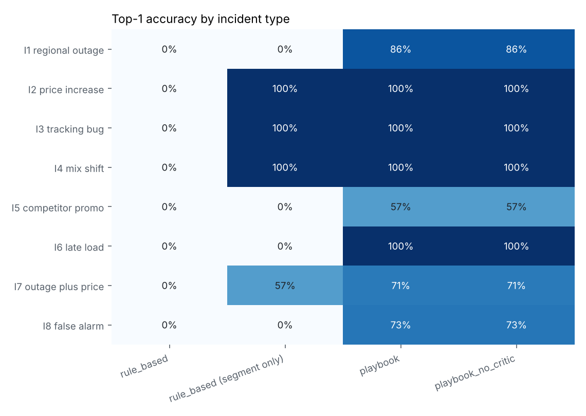
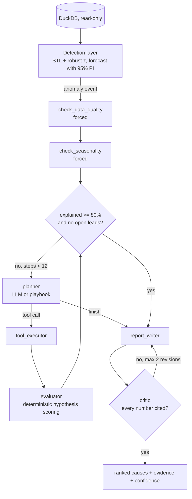
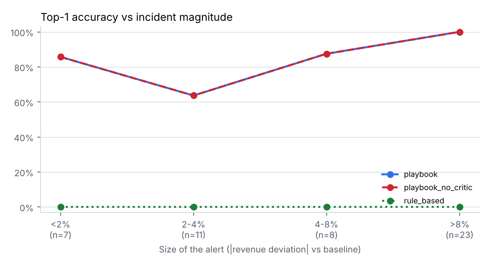

# KPI Detective

**An agent that investigates why a business KPI dropped, and a benchmark of 120 planted incidents that measures how often it is right.**

When revenue drops 12% on a Tuesday, an analyst spends hours on the same routine: confirm the drop is real and not seasonal, check the data is not broken, slice by region, product, channel and customer, separate price from volume from mix, test significance, write it up. KPI Detective automates that routine. It detects the anomaly, plans an investigation, calls deterministic statistical tools, and returns up to three ranked likely causes with evidence and confidence. A critic checks every number in the report against the tool outputs before anyone sees it.

The core of the project is the evaluation, not the agent: a synthetic electronics company with known, planted incidents, so accuracy can be measured exactly and compared with simpler baselines.

## Results at a glance

Held-out **test** split: 60 scenarios with sampled parameters and data seeds that were never used while building the system.

| System | Top-1 | Top-3 | Right segment (mechanism ignored) | Classification | False alarms handled | Unsupported numbers | Avg tool calls |
|---|---|---|---|---|---|---|---|
| Rule-based (contribution analysis) | 0% | 0% | 42% | 58% | 0% | 0% | 5.0 |
| Playbook in the full graph (no LLM) | **85%** | 77% | 87% | 87% | 73% | 0% | 7.9 |

* The rule-based baseline points at the right segment 42% of the time but can never say *why* (price, mix or volume), never recognises broken data and never recognises a seasonal dip. Under the strict rules it scores 0%.
* The playbook scores 92% top-1 on the dev split it was built on and 85% on the held-out split. That 7-point gap is the honest measure of over-fitting.
* Every top-1 miss is an alert of 3.1% or less, a dominant-child ambiguity, or a seasonal dip that differs from last year. The biggest weakness is two simultaneous causes: the playbook finds one of them in 5 of 7 I7 cases but **both in 0 of 7** on the test split (3 of 7 on dev). See [failure case studies](#failure-case-studies).

> **LLM agent results are not in this table yet.** The LLM agent, the single-prompt LLM baseline and the critic ablation run with one command once an API key is set (see [Run it](#run-it)). The offline playbook uses the same graph, tools, evaluator and critic, with a scripted policy in place of the LLM, so the whole pipeline runs and is tested without an API key. The table above makes no claim about LLM accuracy.



## Architecture

The design principle: **the LLM never calculates a number.** All maths happens in deterministic, unit-tested Python tools. The LLM decides which analysis to run next and how to word the conclusion. A deterministic evaluator scores hypotheses from tool outputs, and a critic rejects any report number that cannot be traced to a tool output.



| Layer | What it does | Where |
|---|---|---|
| Synthetic data | 3 years x 396 daily cells (11 countries, 3 channels, 4 categories, 3 segments). Weekly and yearly seasonality, Black Friday, quarter-end pushes, post-holiday lull, growth trend, negative binomial counts | `src/kpi_detective/data/generator.py` |
| Incidents | 8 incident types injected into clean data, each with its own ground truth | `data/incidents.py` |
| Detection | MSTL decomposition scored with a robust z-score (median, MAD, threshold 3.5), and a calendar-aware regression forecaster that flags days outside the 95% prediction interval | `detection/` |
| Toolkit | 8 tools returning structured JSON, all validated and unit tested | `tools/` |
| Agent | LangGraph state machine with forced first steps, 12-call budget, explained-share stopping rule and critic loop | `agent/graph.py` |
| Evaluator | Turns tool outputs into hypotheses: share of the drop, concentration, mechanism, significance | `agent/evaluator.py` |
| Critic | Resolves every claim's JSON path in the cited evidence; checks every number in the prose is a faithful rounding of a verified claim | `agent/critic.py` |
| UI | Streamlit: KPI chart with both detectors' flags, run an investigation, report and expandable trace | `app/streamlit_app.py` |

### The statistical toolkit

| Tool | Method |
|---|---|
| `check_data_quality` | Row counts vs the weekday baseline (partial loads), NULL rates, segments whose revenue became all zero or NULL at single-dimension and dimension-pair level, reported at the coarsest level that explains the problem |
| `check_seasonality` | Window change vs the weekday-aligned window 364 days earlier. Noise is the MAD of event-free windows over the past year, so holidays in the history do not inflate it |
| `get_event_calendar` | Known business events around the window, this year and last |
| `compare_periods` | All metrics plus average price, conversion rate and units per order, optionally by up to 2 dimensions |
| `contribution_analysis`, `drill_down` | Share of the total change per segment, concentration (share of change / share of baseline) and the change of the rest of the parent |
| `decompose_revenue` | Price-volume-mix decomposition that adds up exactly to the revenue change (tested) |
| `significance_test` | Mann-Whitney U (or robust z for 1-2 day windows) against up to a year of event-free history, Benjamini-Hochberg corrected |

Every tool uses one baseline: the same weekday in the 4 weeks before the anomaly window starts, so multi-day windows never contaminate their own baseline.

## Benchmark design

**Incidents.** 8 types x 7 variations, plus 11 false alarms, in each of two splits.

| ID | Incident | What must be found |
|---|---|---|
| I1 | Online orders in one country drop for 1-3 days | country + channel |
| I2 | Category price rises 6-15%, units fall through elasticity | category (and region if regional), mechanism = price |
| I3 | One channel's revenue recorded as zero or NULL | channel (and region if regional), mechanism = data quality |
| I4 | 20-45% of Enterprise units shift to Consumer, total units stable | Enterprise, mechanism = mix |
| I5 | One category in one region declines gradually over 10 days | region + category |
| I6 | Latest day only partly loaded | data quality, no segment |
| I7 | Outage and price increase at once | both causes in the top 3 |
| I8 | Nothing injected: a normal post-holiday or post-quarter-end dip | "expected seasonal behaviour" |

**Splits.** `dev` scenarios were designed by hand and used while building the tools and the playbook. `test` scenarios have parameters sampled from ranges, new windows and new data seeds, and were only run after development stopped. Three test alerts are weaker than 1% and were kept rather than resampled, to avoid cherry-picking.

**Matching rules** were written before the first run (`evaluation/matching.py`): the predicted segment must equal the true segment exactly (too broad and too narrow are both wrong), and where the incident defines a mechanism (price, mix, data quality) it must match too. Scenarios are 60 KB of JSON; data is regenerated deterministically from each spec.

## Results

Full tables: [`results/test/results.md`](results/test/results.md), [`results/dev/results.md`](results/dev/results.md), and [`notebooks/02_results_analysis.ipynb`](notebooks/02_results_analysis.ipynb).

### Accuracy by incident type (test)

| Incident | Rule-based (strict) | Rule-based (segment only) | Playbook |
|---|---|---|---|
| I1 outage | 0% | 0% | 86% |
| I2 price increase | 0% | 100% | 100% |
| I3 tracking bug | 0% | 100% | 100% |
| I4 mix shift | 0% | 100% | 100% |
| I5 gradual decline | 0% | 0% | 57% |
| I6 late load | 0% | 0% | 100% |
| I7 two causes | 0% | 57% | 71% |
| I8 false alarm | 0% | 0% | 73% |

The rule-based baseline names the right segment for single-dimension incidents (I2, I3, I4), but calls a tracking bug a business problem and has no answer for false alarms, partial loads or two-dimensional causes.

### Accuracy vs incident size



Large alerts (over 8%) are solved 100% of the time. The weakest bucket is 2-4%, where incidents are only 2-3 times the noise of the naive alert (about 1.3% for a 3-day window).

### Detection layer (test)

| Detector | Recall on I1-I7 | False positives on I8 |
|---|---|---|
| Naive rule: 5% below the 4-week weekday baseline | 53% | 100% |
| STL + robust z-score (3.5) | 57% | 45% |
| Calendar-aware forecast, 95% PI | **82%** | **18%** |

Two findings worth knowing. First, a robust STL fitted through the end of the series absorbs a fresh anomaly into its own trend; scoring the latest 14 days out of sample against the extrapolated decomposition fixes this. Second, with only 2-3 years of history, the yearly STL component memorises each day of the year, so the residual scale is computed against last year's component. The forecast detector wins because it knows the event calendar, including the weekday/weekend split of B2B events.

### Cost and speed

The playbook runs an investigation in 0.27 s on average with 7.9 tool calls (2 for data-quality issues, up to 12 for outages and two-cause incidents). LLM cost and latency per investigation are reported by the benchmark when run with a provider (`--price-in/--price-out` set the token prices).

## Failure case studies

All 9 top-1 misses on the test split fall into three groups, plus one systematic top-3 failure. Full traces are in `results/test/runs.jsonl`.

**1. Small alerts (5 of 9).** TI1_05 (India online outage, alert -2.2%), TI5_06, TI5_07, TI7_01 and TI7_02 all have alerts of 3.1% or less. In TI1_05 Indian online sales are about 2% of revenue, so the outage is no bigger than ordinary day-to-day movement in Enterprise sales, which is what the drill-down follows instead. In TI7_01 (UK outage + monitor price rise, -2.2%), the playbook confirms the UK online drop's volume mechanism but its significance test is not significant at 4 days with an outage on 2 of them (q = 0.11), and the 12-call budget ends before the monitor price cause is confirmed. Both are honest outcomes: the system reports "inconclusive" rather than inventing a cause.

**2. Dominant child ambiguity (1 of 9).** TI5_01 plants a monitor decline in NA. The US is about 85% of NA, so "US monitors" explains the drop almost as well as "NA monitors", and the playbook stops one level too deep. Telling them apart needs a sibling test (did Canada's monitors fall too?), which the `rest_pct_change` field already supports for the top level but not yet for this path.

**3. Seasonal dips that differ from last year (3 of 9).** In TI8_05 (2-4 Apr 2025, the week after quarter end) last year's dip explains only 52% of this year's, so `check_seasonality` returns "unusual" and the Enterprise direct-sales drop that carries the quarter-end hangover is reported as a business change. TI8_04 (27-30 Dec 2025) is subtler: the seasonal check does say "expected" (last year explains 78%), but 78% is under the 80% stopping target, so the investigation continues, confirms that Consumer carries the dip, and the rule that a confirmed business cause above 30% outranks seasonality turns it into a business change. TI8_02 ends "inconclusive". The fix for all three is year-over-year comparison per segment, so a segment only counts as a cause if it fell more than it did last year. This was found on the test split and deliberately **not** patched, so the test numbers stay clean.

**4. Two causes at once (top-3 fails in 7 of 7 test I7 cases).** Take TI7_04 (Germany online outage plus a 14% laptop price rise, alert -11.0%). The laptop price effect is found and confirmed in 8 calls, and because laptops alone account for 107% of the drop, the explained share hits 100% immediately. The open-leads rule keeps the loop going, but the next strongest unconfirmed lead is Consumer (the price rise hits consumer laptops), not Germany, so the remaining budget confirms a side effect of the first cause instead of the second cause. EMEA shows up in the region split but is never drilled down to Germany. A cause that explains more than 100% of the drop hides everything else. The fix is to recompute contributions on the *residual* after removing a confirmed cause's segment, which is a natural job for an LLM planner and a strong argument for one.

## Was an agent needed?

On this evidence, an investigation *loop* is clearly needed: the one-shot rule-based baseline scores 0% under strict matching and 42% on segment alone, while the same tools in a plan-act-verify loop score 85%. Forced data-quality and seasonality checks alone account for I3, I6 and most of I8.

Whether an **LLM** planner beats the scripted playbook is the open question this repo is built to answer, and the answer is not in yet. Expect the LLM to matter most where the playbook fails: finding the second cause once the first explains everything (I7 top-3 is 0% for the playbook on test), choosing between a parent and a dominant child, and reading the event calendar. The critic ablation is only meaningful with an LLM writer: the scripted writer formats numbers straight from evidence, so it cannot produce unsupported claims (0% with and without the critic, as expected).

## Limitations

* **Likely drivers, not proven causes.** The system finds where and how the drop happened. It does not prove causality.
* **Synthetic data may be easier than reality.** Real data has messier hierarchies, late-arriving corrections and incidents with no clean segment boundary. The generator adds noise, small incidents and overlapping causes to reduce this risk, and the accuracy-vs-magnitude chart shows where it breaks.
* **Additive metrics only.** Ratio metrics such as conversion rate (where numerator and denominator both move) are a stretch goal.
* **One seasonal model.** An incident hidden inside a seasonal dip of similar size would be missed.

## Run it

```bash
uv sync --all-extras                      # or: pip install -e ".[llm,app,dev]"
pytest                                    # 54 tests, about 25 s
kpi-detective investigate --scenario TI1_04 --trace
kpi-detective benchmark --split test      # offline systems, about 80 s
streamlit run app/streamlit_app.py
```

With an LLM:

```bash
export ANTHROPIC_API_KEY=...
kpi-detective benchmark --split test --provider anthropic \
    --systems rule_based,single_prompt,agent_no_critic,agent --repeats 3
# local model, for development and the cost comparison
kpi-detective benchmark --split test --provider ollama --model qwen2.5:14b --systems agent
```

Other commands: `kpi-detective scenarios` rebuilds both splits; `kpi-detective detect --scenario TI2_03` runs both detectors; `python -m kpi_detective.evaluation.evaluate_detection --scenarios data/scenarios/test --out results/test` reruns the detection evaluation.

## Repository

```
kpi-detective/
├── src/kpi_detective/
│   ├── data/            generator, calendar, incidents, scenarios (dev + held-out test)
│   ├── detection/       STL robust-z detector, forecast detector, naive baseline alert
│   ├── tools/           8 statistical tools + registry with validation
│   ├── agent/           LangGraph graph, state, evaluator, policies, prompts, critic, LLM clients
│   ├── baselines/       rule-based, single-prompt LLM
│   ├── evaluation/      matching rules, metrics, benchmark runner, detection eval, plots
│   ├── store.py         read-only DuckDB access
│   └── cli.py
├── data/scenarios/      dev/ and test/ scenario specs (JSON)
├── results/             benchmark outputs, tables and figures per split
├── app/                 Streamlit demo
├── notebooks/           01 EDA, 02 results analysis (executed)
├── tests/               54 tests: tools, generator, incidents, detection, critic, matching, agent, app
└── scripts/             notebook builder
```

## Guardrails

Read-only database (DuckDB opened read-only, plus a SELECT-only query guard), tool inputs validated against the allowed dimensions and values, a 12-call budget, forced data-quality and seasonality checks, temperature 0 and fixed seeds, and up to 2 critic-driven revisions. Tool errors go back to the planner as structured errors and still count against the budget.

## What would change for production

Real data connectors with per-source freshness checks, a human approval step before any report is sent, monitoring of agent accuracy on newly labelled incidents, access controls on the underlying data, and per-segment year-over-year seasonality.
